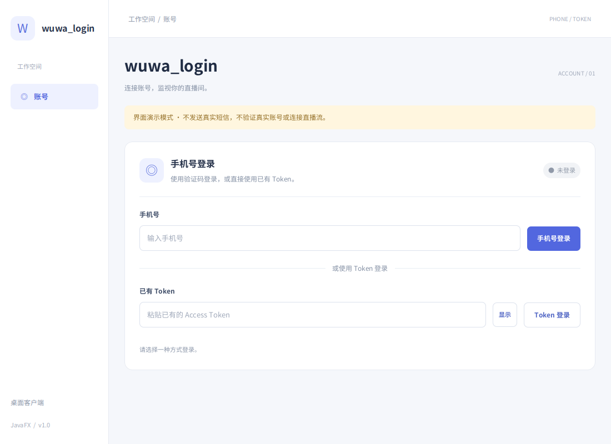
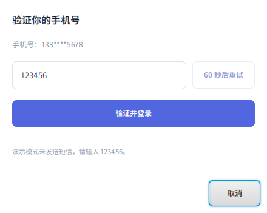
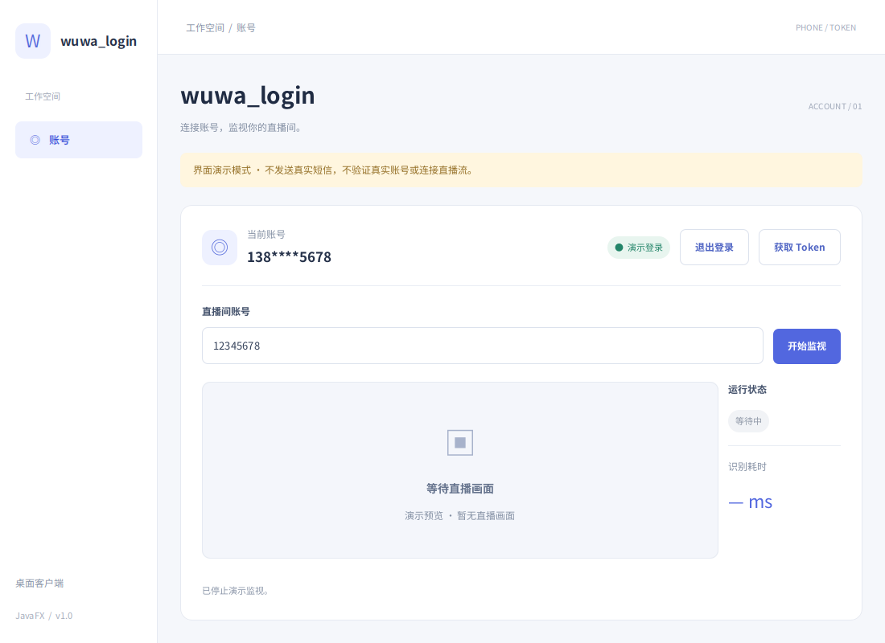

# wuwa_login · JavaFX 登录与直播监视界面

JDK 25 + JavaFX 21。当前是第一阶段的界面与交互演示，真实短信、账号认证、直播取流及扫码 API 留到后续阶段实现。

## 运行

安装 JDK 25 和 Maven 3.9，在项目目录执行：

```bash
mvn javafx:run
```

IntelliJ IDEA 中重新加载 Maven 项目，也可运行 `org.example.Main`。

默认开启**界面演示模式**，窗口标题和页面顶部均有明确标注。不会发送真实短信、验证真实 Token 或连接直播间；请使用测试数据。

- **手机号登录**：输入 11 位手机号，点击「手机号登录」，在弹窗获取验证码，输入演示验证码 `123456` 后登录。验证码按钮有 60 秒重试倒计时。
- **已有 Token**：直接输入任意不含空白字符的测试 Token 并登录，无需手机号。
- **登录后**：显示当前账号（手机号脱敏），支持退出登录、获取 Token、显示/隐藏和复制 Token。
- **直播监视页**：输入直播间账号或房间号，演示开始/停止监视；保留画面预览、运行状态和识别耗时区域。没有真实画面时不显示虚构耗时。

手机号演示登录会生成带 `demo-` 前缀的临时 Token，不能用于真实平台。已有 Token 登录会在演示会话中保留输入值，但不会验证其有效性。凭据只保存在内存，退出后清除；主动复制的 Token 会保留在系统剪贴板。

## 下一阶段：接入真实服务

`AuthService` 提供三个异步方法：`sendCode(phone)`、`loginWithPhone(phone, code)`、`loginWithToken(token)`。认证成功必须返回含账号和 Token 的 `Session`；界面使用返回会话显示账号和导出 Token。

将 `TokenClientApp` 中的未配置服务替换为真实实现，再关闭演示模式：

```bash
mvn javafx:run -Dapp.demo=false
```

未接入 API 时，关闭演示模式会明确提示接口尚未接入，不会显示登录成功。网络请求应立即返回 `CompletionStage`，不要阻塞 JavaFX 线程。若实际接口要求人机验证，应在该阶段接入正常验证流程。

登录指南、平台选择和原来的浏览器获取 Token 地址已移除。「获取 Token」现在显示当前登录返回的 Token。

## 界面预览

登录页：



验证码弹窗：



登录后的直播监视页：



## 验证与预览

```bash
mvn test
mvn test -Dpreview.dir=target/previews
```

测试通过 Monocle 运行真实 JavaFX 界面，覆盖两种登录方式、验证码倒计时与失败重试、重复提交、取消后的延迟响应、Token 导出、退出清理，以及监视按钮状态。可选参数生成登录页、验证码弹窗和监视页预览。
